# 👋 Hello, I'm Shalaka!

I'm a **quality engineer** 🧪 who fell in love with **AI** 🤖  
For 9+ years I've been finding what breaks in banking, payments, telecom and retail systems.  
Now I do the same for **LLMs**: making AI behaviour measurable, traceable and safe to release.

🎓 MSc in Artificial Intelligence · ISTQB CT-AI certified · based in London 🇬🇧

My favourite build so far is **[TestScope AI](https://github.com/jshalaka/testscope-ai-uat-agent)**, a local AI agent that turns requirements into risk-based UAT tests.  
The model drafts, Python guardrails check its work, and a human makes the final call ✅

I'm always happy to talk about **AI evaluation**, **LLM testing** and **quality engineering** 💬  
⭐️ Feedback, ideas and code reviews are very welcome!

Thank you for visiting my page ❤️

[Portfolio](https://jshalaka.github.io/shalaka-ai-evaluation-portfolio/) · [LinkedIn](https://www.linkedin.com/in/svjaitapkar) · [Email](mailto:jaitapkar.shalaka@gmail.com) · [Résumé](https://jshalaka.github.io/shalaka-ai-evaluation-portfolio/downloads/Shalaka_Jaitapkar_Resume.pdf)
